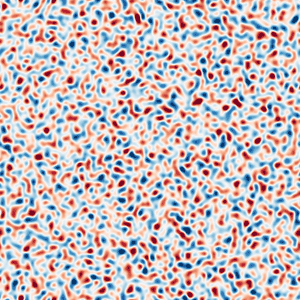
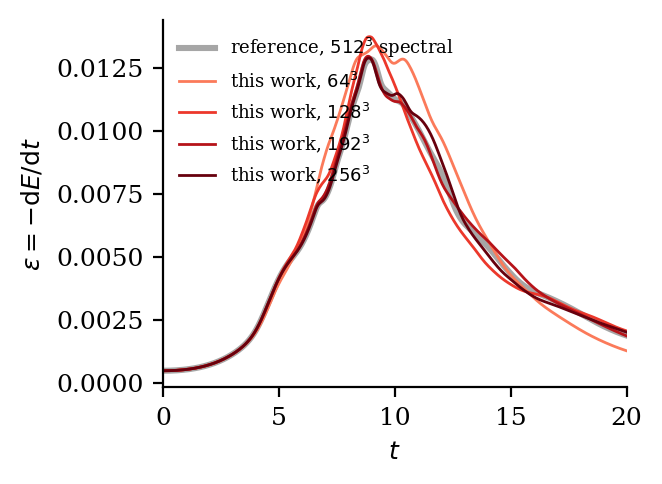
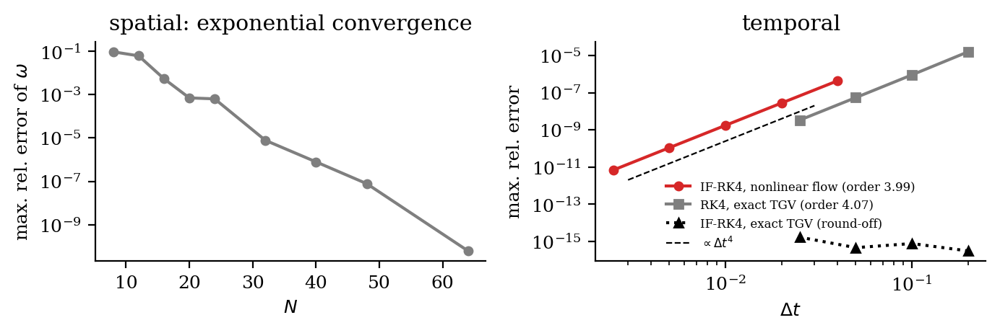
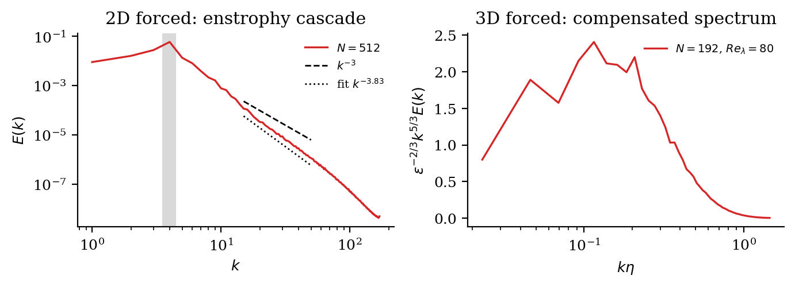
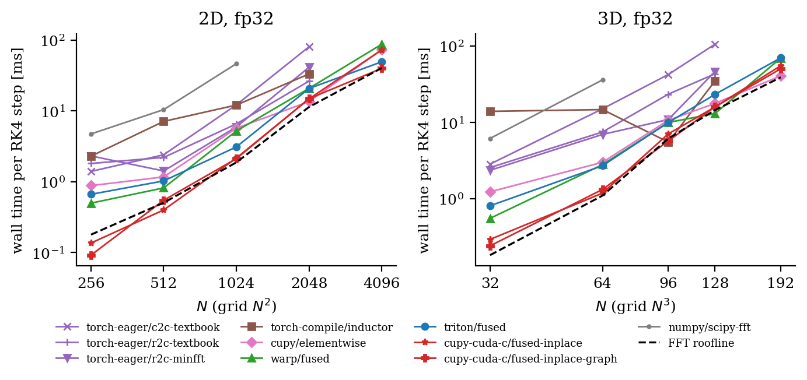
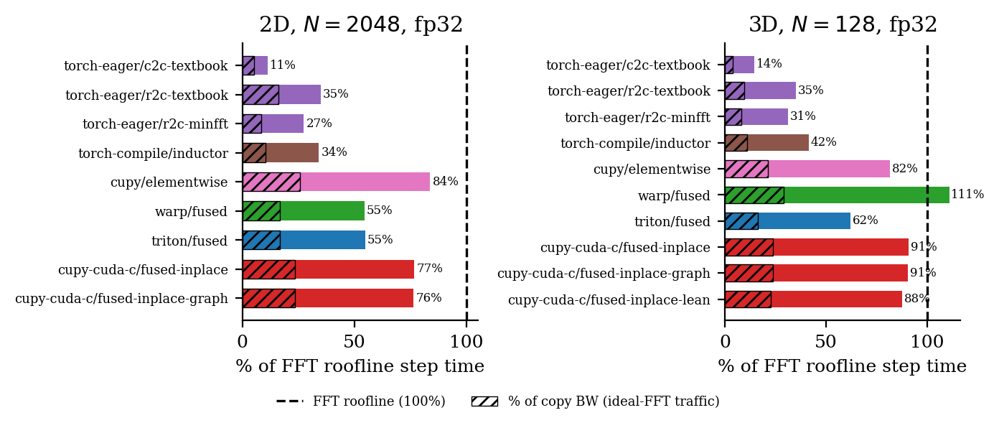

# pyspectral

**Pseudo-spectral DNS of incompressible turbulence on the GPU from Python, measured against the FFT roofline.**

[](https://github.com/walidhemati/pyspectral/actions/workflows/ci.yml)
[](LICENSE)
[](pyproject.toml)
[](paper/paper.pdf)



*Vorticity of freely decaying 2D turbulence (768², fp32, `cupy-cuda-c` backend). Small vortices merge into ever larger ones.*

## Headline result

<!-- headline:start -->
| | grid | fastest variant | time / RK4 step | throughput | % of FFT roofline | effective BW (% of 361 GB/s) |
|---|---|---|---|---|---|---|
| 2D | $8192^2$ | `cupy-cuda-c/fused-inplace` | 122.63 ms | 547 Mpts/s | 99 % | 164 GB/s (45 %) |
| 3D | $384^3$ | `cupy-cuda-c/fused-inplace-lean` | 182.44 ms | 310 Mpts/s | 103 % | 201 GB/s (56 %) |

GPU: NVIDIA GeForce RTX 3070 Laptop GPU, fp32, 5 repeats (median).
<!-- headline:end -->

The **FFT roofline** is the step time you would get if every FFT ran at the speed of a
standalone cuFFT call for exactly the same batched transforms, and all the remaining
pointwise work moved the minimum number of bytes at the 361 GB/s measured copy bandwidth. A
pseudo-spectral step can't beat it without changing the FFT library.

## What's inside

- **Physics.** 2D vorticity–streamfunction and 3D velocity (rotational form `u × ω` with Leray
  projection) on a periodic `[0, 2π)^d` box. 2/3-rule dealiasing; optional random phase shifts
  with spherical truncation (NumPy and torch-eager backends). Integrating-factor RK4 (Lawson)
  with exact viscosity, CFL-adaptive `dt`, linear drag (uniform, or restricted to large scales),
  and constant-power band forcing for stationary turbulence.
- **Fewest FFTs per stage.** Basdevant's trick evaluates the nonlinear term with **4** FFTs per
  RK stage in 2D and **8** in 3D. The textbook forms take 5 and 9.
- **One interface, every rung of the optimisation ladder** (`pyspectral list`):

| variant | what it is |
|---|---|
| `numpy/scipy-fft` | NumPy + `scipy.fft` on all CPU threads: the correctness oracle, runs in CI |
| `torch-eager/c2c-textbook` | eager PyTorch, complex-to-complex FFTs, textbook FFT count |
| `torch-eager/r2c-textbook` | eager PyTorch, real-to-complex FFTs, textbook FFT count |
| `torch-eager/r2c-minfft` | eager PyTorch, r2c FFTs, minimal (Basdevant) FFT count |
| `torch-compile/inductor` | `torch.compile` fuses the pointwise phases; FFTs via `torch.fft` |
| `cupy/elementwise` | CuPy `ElementwiseKernel` fusion + `cupyx.scipy.fft` plan cache |
| `warp/fused` | NVIDIA Warp fused kernels on torch buffers, FFTs via `torch.fft` |
| `triton/fused` | Triton fused kernels, FFTs into preallocated buffers |
| `cupy-cuda-c/fused-inplace` | hand-written CUDA C (NVRTC) + in-place batched cuFFT plans |
| `cupy-cuda-c/fused-inplace-lean` | same, single-field plans (smallest memory) |
| `cupy-cuda-c/fused-inplace-graph` | same, one time step replayed as a CUDA graph |

## Quick start

```bash
pip install -e ".[gpu]"          # or: pip install -e .   (NumPy reference only)
pyspectral list                  # which backends work on this machine
pyspectral run --backend cupy-cuda-c --dim 3 --n 128 --case tgv --nu 6.25e-4 --dtype float32 --t-end 2
pyspectral validate --what 2d,backends     # writes results/validation_*.json
python bench/run.py --quick                # < 2 min benchmark smoke test
```

## Validation

<!-- validation:start -->
| check | result |
|---|---|
| 2D Taylor-Green, exact decay (all 11 variants) | max rel. error 3.1e-15 (fp64), 7.0e-06 (fp32) |
| RK4 temporal order on exact TGV | 4.07 |
| IF-RK4 self-convergence, nonlinear 2D flow | order 3.99 |
| spectral convergence in $N$ (smooth 2D flow) | error 6.1e-11 at $N=64$ |
| every GPU variant vs NumPy fp64 oracle (64 cases) | max rel. 1.3e-15 (fp64), 8.3e-07 (fp32) |
| 3D TGV Re=1600, $64^3$ vs $512^3$ reference | peak $\varepsilon$ 0.01340 at t=9.20 (ref. 0.01286 at 8.97); max dev. 14.9 % of peak |
| 3D TGV Re=1600, $128^3$ vs $512^3$ reference | peak $\varepsilon$ 0.01376 at t=8.90 (ref. 0.01286 at 8.97); max dev. 9.5 % of peak |
| 3D TGV Re=1600, $192^3$ vs $512^3$ reference | peak $\varepsilon$ 0.01298 at t=8.85 (ref. 0.01286 at 8.97); max dev. 3.1 % of peak |
| 3D TGV Re=1600, $256^3$ vs $512^3$ reference | peak $\varepsilon$ 0.01291 at t=8.90 (ref. 0.01286 at 8.97); max dev. 5.9 % of peak |
| forced 2D, $N=512$, enstrophy range | $E(k)\sim k^{-3.83}$ (Kraichnan: $k^{-3}$) |
| forced 3D, $N=192$, $Re_\lambda=80$ | fitted slope -1.48 (K41: $-5/3$) |
<!-- validation:end -->



The 3D Taylor–Green vortex at Re = 1600 is checked against the 512³ pseudo-spectral
dissipation history distributed by the 1st International Workshop on High-Order CFD Methods
(case C3.5; `data/reference/`). Every GPU variant is checked against the NumPy oracle in 2D and
3D, in fp32 and fp64, with forcing, drag and a changing `dt` (`tests/test_backends.py`).




## Performance




<!-- perf-table:start -->
| grid | variant | FFTs/step | ms/step | Mpts/s | GB/s | % copy BW | % FFT roofline |
|---|---|---|---|---|---|---|---|
| $4096^2$ | `cupy-cuda-c/fused-inplace` | 16 | 26.25 | 639 | 192 | 53 | 102 |
| $4096^2$ | `cupy-cuda-c/fused-inplace-graph` | 16 | 26.68 | 629 | 189 | 52 | 101 |
| $4096^2$ | `warp/fused` | 16 | 35.06 | 479 | 144 | 40 | 77 |
| $4096^2$ | `triton/fused` | 16 | 35.07 | 478 | 144 | 40 | 77 |
| $4096^2$ | `cupy/elementwise` | 16 | 39.34 | 426 | 128 | 35 | 68 |
| $4096^2$ | `torch-compile/inductor` | 16 | 39.52 | 424 | 127 | 35 | 68 |
| $4096^2$ | `torch-eager/r2c-minfft` | 16 | 65.01 | 258 | 77 | 21 | 41 |
| $4096^2$ | `torch-eager/r2c-textbook` | 20 | 71.90 | 233 | 85 | 24 | 45 |
| $4096^2$ | `torch-eager/c2c-textbook` | 20 | 127.20 | 132 | 48 | 13 | 26 |
| $256^3$ | `cupy-cuda-c/fused-inplace-graph` | 32 | 51.59 | 325 | 210 | 58 | 105 |
| $256^3$ | `cupy-cuda-c/fused-inplace` | 32 | 51.67 | 325 | 210 | 58 | 105 |
| $256^3$ | `warp/fused` | 32 | 67.85 | 247 | 160 | 44 | 80 |
| $256^3$ | `triton/fused` | 32 | 68.15 | 246 | 159 | 44 | 79 |
| $256^3$ | `cupy/elementwise` | 32 | 72.09 | 233 | 151 | 42 | 75 |
| $256^3$ | `torch-compile/inductor` | 32 | 84.71 | 198 | 128 | 35 | 64 |
| $256^3$ | `torch-eager/r2c-textbook` | 36 | 184.68 | 91 | 65 | 18 | 32 |
| $256^3$ | `torch-eager/r2c-minfft` | 32 | 184.83 | 91 | 59 | 16 | 29 |
<!-- perf-table:end -->

The traffic model behind "GB/s" counts one read and one write per FFT, a lower bound, since
real multi-dimensional FFTs make several passes. So the effective bandwidth is never inflated.

<!-- counterparts:start -->
**Head-to-head** (`bench/counterparts.py`, same machine, *provisional shared-GPU quick run*): at $1024^2$ (2D, fp32) `cupy-cuda-c/fused-inplace` takes 1.53 ms per step, 2.9x faster than JAX-CFD's spectral solver with its own CN-RK4 stepper and 2.2x faster than JAX-CFD's right-hand side inside the same IF-RK4; at $64^3$ (fp64) spectralDNS on 8 MPI ranks needs 74.1 ms per RK4 step on the CPU and the NumPy oracle 96.0 ms; `cupy-cuda-c` is 18x faster than spectralDNS; Dedalus (gpu branch) needs 5.8x the step time of `cupy-cuda-c` at $48^3$. Each code was checked against the pyspectral NumPy oracle on the same initial condition (see the paper).
<!-- counterparts:end -->

## How it works

Each RK4 stage runs four operations: a batched in-place C2R FFT, one fused physical-space kernel
for the products, a batched in-place R2C FFT, and one fused spectral kernel. The spectral kernel
assembles the nonlinear term, applies dealiasing and projection, performs the IF-RK4 update, and
writes the next stage's FFT inputs directly. No temporaries are allocated. The integrating
factor `exp(-ν k² Δt)` factorises over the axes, so the kernels read it from a tiny 1D table
instead of evaluating `exp` per mode. That matters in fp64 on a consumer GPU.

The ladder, from slow to fast:

1. NumPy/SciPy on the CPU.
2. Eager PyTorch with complex FFTs.
3. Real-to-complex FFTs.
4. Minimal FFT count.
5. Fused pointwise kernels (Inductor, CuPy, Warp, Triton).
6. Hand-written CUDA C with in-place cuFFT.
7. CUDA graphs.

See the paper for the measured effect of each rung.

## Reproduce the paper

```bash
python bench/run.py --full           # idle GPU, ~25 min -> results/rtx3070-laptop.json
python bench/counterparts.py --full  # idle GPU+CPU: JAX-CFD, spectralDNS, Dedalus head-to-heads
scripts/validate.sh                  # validation runs -> results/validation_*.json
python figures/make_figures.py       # figures/*.pdf|png, paper/results.tex, README tables
python figures/make_hero.py          # docs/media/hero.gif
cd paper && tectonic paper.tex
```

## Citation

```bibtex
@software{hemati2026pyspectral,
  author = {Hemati, Walid},
  title  = {pyspectral: pseudo-spectral turbulence DNS near the FFT roofline from Python},
  year   = {2026},
  url    = {https://github.com/walidhemati/pyspectral}
}
```

MIT licensed, see [LICENSE](LICENSE).

---

Part of the **Python-HPC suite**:
[pylbm](https://github.com/walidhemati/pylbm) ·
[pyheat3d](https://github.com/walidhemati/pyheat3d) ·
[pygravity](https://github.com/walidhemati/pygravity) ·
[pymd](https://github.com/walidhemati/pymd) ·
[pyising](https://github.com/walidhemati/pyising) ·
[pyspectral](https://github.com/walidhemati/pyspectral)
